# AI-DAST-ING — Architecture Diagrams (agent-oriented)

> **Audience:** AI coding agents (and humans) who need a fast, accurate mental
> model of this repo before editing it. Prose details live in
> [`ARCHITECTURE.md`](ARCHITECTURE.md); this file is the *map*. Diagrams are
> Mermaid (renders on GitHub; readable as text). Paths are repo-relative.
> Module path: `github.com/barhaterahul/ai-dast-ing/v4`.

**One-sentence model:** a single Go binary (`cmd/ai-dast-ing`) serves an
embedded React dashboard + REST/WebSocket API (`internal/web`), which launches
per-scan LLM agent loops (`internal/agent`) that call tools
(`internal/tools/*`) against an authorized target, record hypotheses/evidence
in a scan-scoped ledger (`internal/scanctx`), and only report findings that an
independent verifier re-exploits.

---

## 1. System context

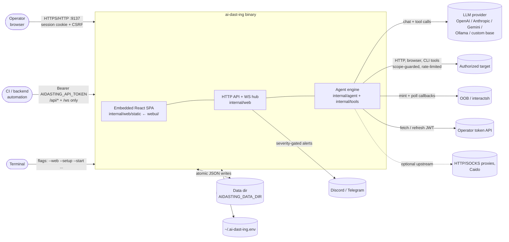

---

## 2. Package layers & dependency direction

Arrows mean "imports / calls". Lower layers never import upper ones.

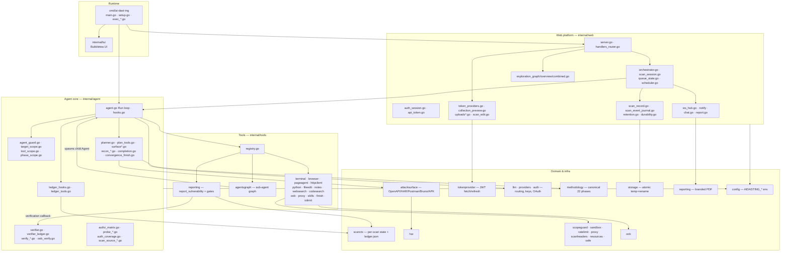

---

## 3. Scan lifecycle (request → report)

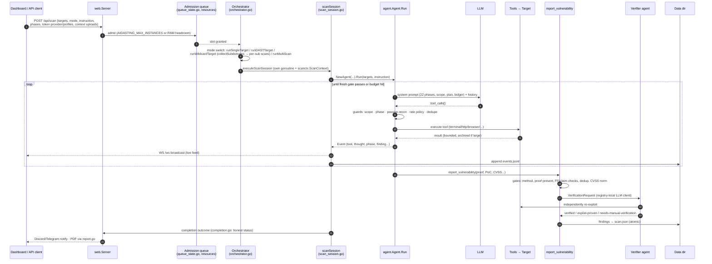

**Scan modes** (`ScanRequest.mode`): `single` (one host, full testing) ·
`dast` (deep crawl → param mining → vuln tests) · `wildcard` (subdomain
enumeration → one sub-scan per subdomain) · multi-target lists go through
`runMultiScan` and the persisted queue (resumable).

---

## 4. Inside one agent loop (`internal/agent/agent.go: Run`)

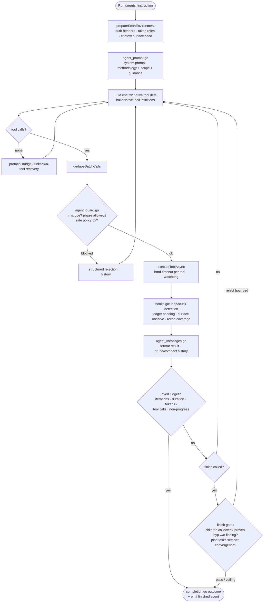

### Multi-agent delegation (`internal/tools/agentsgraph`)

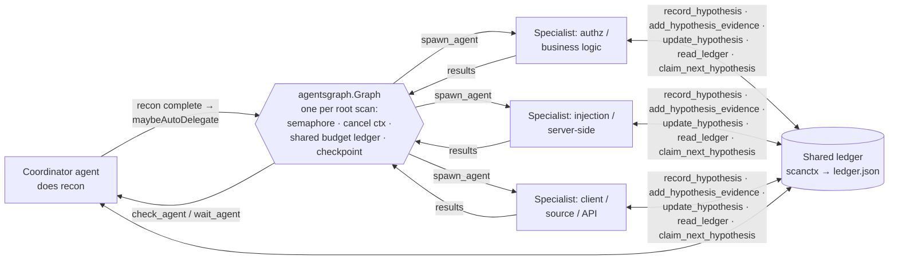

Hypothesis lifecycle in the ledger:

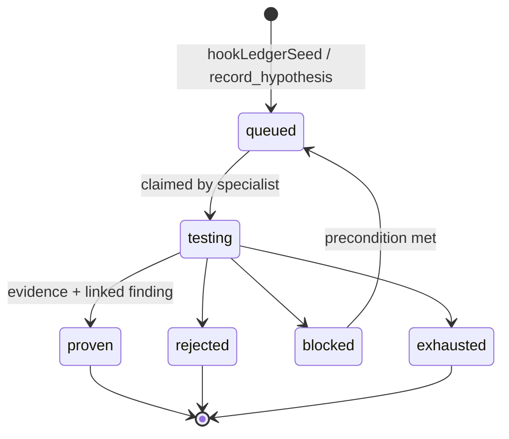

---

## 5. Tool surface (what the LLM can call)

Registered in `internal/tools/registry.go` (+ agent-local tools in `internal/agent`).

| Group | Tool names | Implementation |
|---|---|---|
| Execution | `terminal_execute`, `python_action`, `read_tool_output` | `tools/terminal`, `tools/python`, `agent/tool_archive_tool.go` |
| HTTP | `http_request`, `send_request`, `list_requests` | `tools/httpclient`, `tools/proxy` (Caido) |
| Browser | `browser_action` (incl. `verify_xss`), `page_agent`, `discover_client_routes` | `tools/browser` (headless + ext bridge `localhost:38401/ext`), `tools/pageagent` |
| Recon/intel | `web_search`, `cve_search`, `exploit_search`, `code_search`, `scan_source_routes`, `scan_source_sinks` | `tools/websearch`, `tools/codesearch`, `agent/scan_source_*.go` |
| Planning | `build_plan`, `update_plan`, `ingest_har` | `agent/plan_tools.go`, `agent/har_ingest.go` |
| Ledger | `record_hypothesis`, `add_hypothesis_evidence`, `update_hypothesis`, `read_ledger`, `claim_next_hypothesis`, `record_attempt` | `agent/ledger_tools.go` |
| Deep tests | `authz_matrix`, `probe_hypothesis`, `probe_body_contract` | `agent/authz_matrix.go`, `agent/probe_*.go` |
| Verifiers | `verify_sqli`, `verify_ssti`, `verify_xxe`, `verify_csrf`, `verify_path_traversal`, `verify_authbypass`, `verify_timing`, `verify_oob`, `submit_verdict` | `agent/verify_*.go`, `agent/verifier.go` |
| OOB | `oob_callback` | `tools/oob` → `internal/oob` |
| Multi-agent | `spawn_agent`, `create_agent`, `check_agent`, `wait_agent` | `tools/agentsgraph` |
| Memory/files | `add_note`, `read_notes`, `str_replace_editor`, `list_files`, `search_files` | `tools/notes`, `tools/fileedit` (sandboxed by `internal/sandbox`) |
| Knowledge | `list_skills`, `read_skill`, `search_skills` | `tools/skills` (embedded corpus) |
| Output | `report_vulnerability`, `finish` | `tools/reporting`, `tools/finish` |

---

## 6. Context ingestion & authenticated scanning

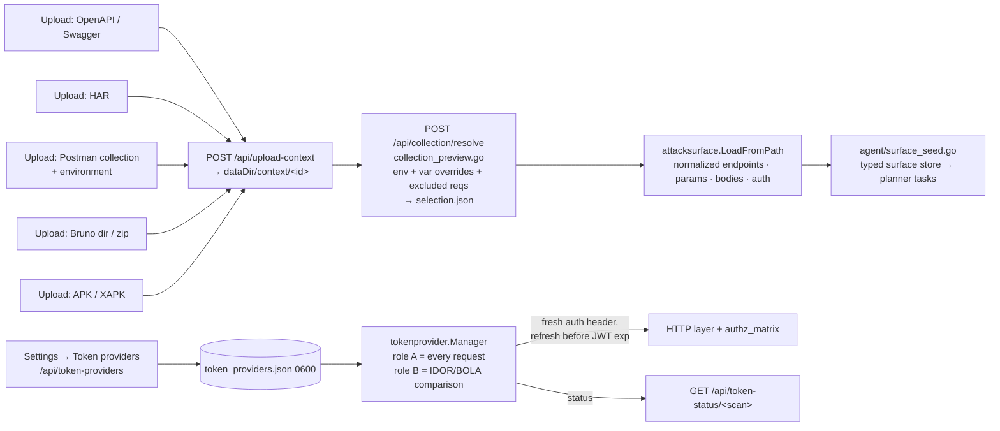

---

## 7. Exploration (read-only analytics over finished scans)

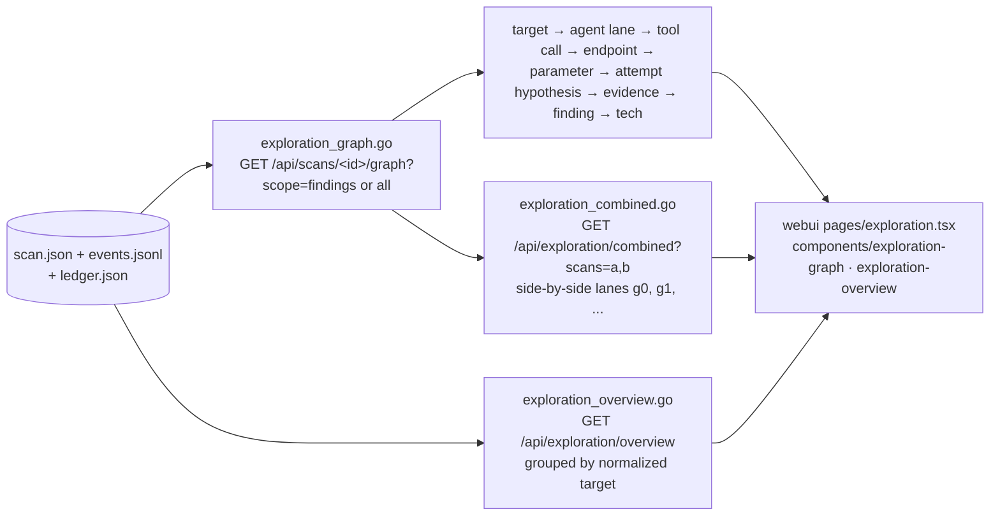

---

## 8. Persistence layout (data dir)

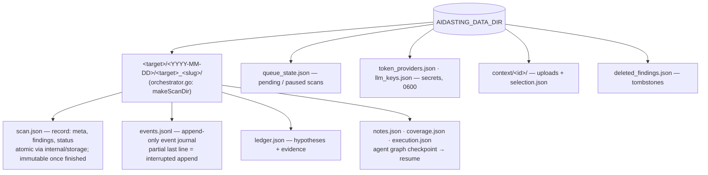

Global-file locations are resolved in `internal/web/data_dirs.go`; verify there before hard-coding paths.

---

## 9. Frontend (`webui/` → embedded at build)

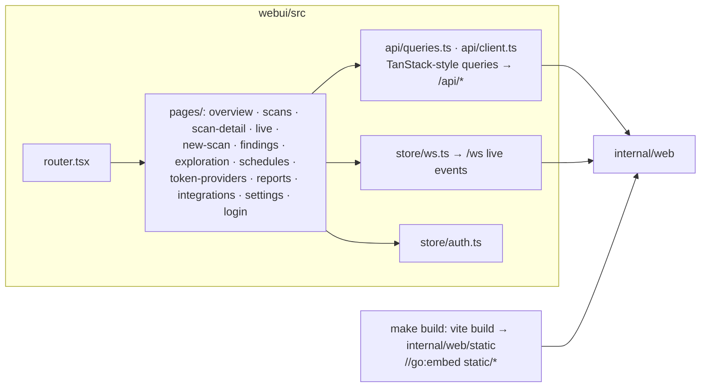

`webui/src/methodology-phases.json` is generated from `internal/methodology`:
`go run ./tools/gen-webui-phases > webui/src/methodology-phases.json` — edit the Go source, then regenerate.

---

## 10. Safety boundaries (do not weaken when editing)

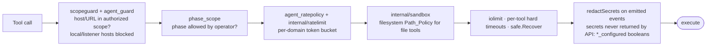

---

## Where to change X (agent quick index)

| Task | Start here |
|---|---|
| Add an API route | `internal/web/handlers_router.go` + handler file in `internal/web/` |
| Add/modify an agent tool | subpackage in `internal/tools/*` → register in `internal/tools/registry.go`; agent-local tools in `internal/agent/*_tools.go` |
| Change the system prompt / methodology text | `internal/agent/agent_prompt.go`, `internal/methodology/` |
| Change finish / completion rules | `internal/agent/completion.go`, `convergence_finish.go`, finish gates in `agent.go` |
| New vuln verifier | `internal/agent/verify_<class>.go` (+ `vuln_classes.go`) |
| Finding gates / verification tags | `internal/tools/reporting/` |
| New context import format | `internal/attacksurface/` (see `postman.go`, `bruno.go`, `collection.go`) |
| Token auth behavior | `internal/tokenprovider/`, `internal/web/token_providers.go` |
| Scan orchestration / modes / resume | `internal/web/orchestrator.go`, `scan_session.go`, `queue_state.go` |
| Persistence format | `internal/web/scan_record.go`, `scan_event_journal.go`, `internal/storage/` |
| LLM providers / routing | `internal/llm/`, `internal/providers/`, `internal/auth/` |
| Config / env vars | `internal/config/` (all `AIDASTING_*`) |
| Dashboard UI | `webui/src/pages/*`, `webui/src/components/*` |

**Build/test:** `make build` (webui + Go binary → `build/ai-dast-ing`), `go test ./...`,
lint via `.golangci.yml`. Use only against targets you are authorized to test.
